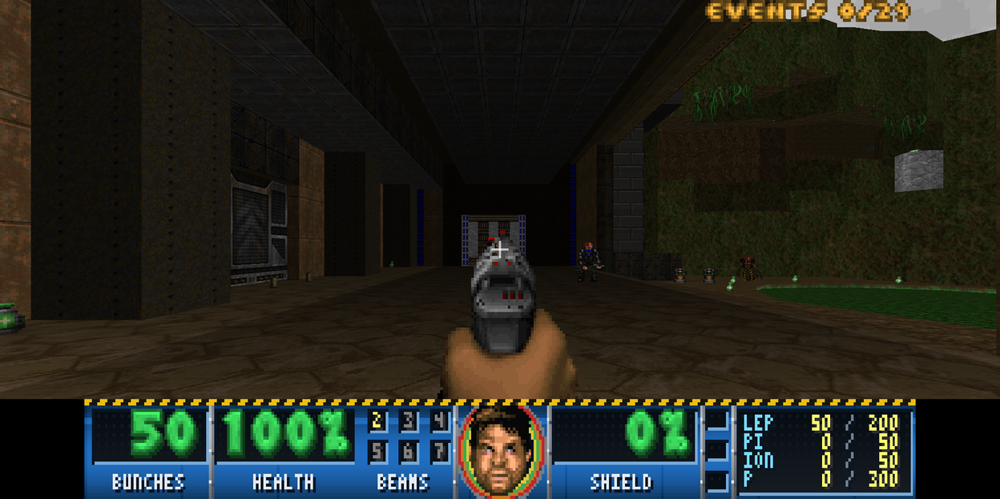
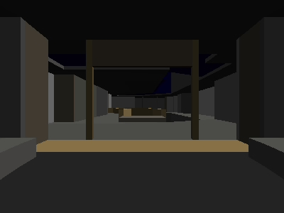
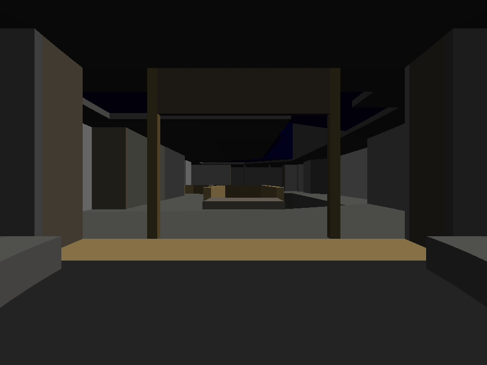
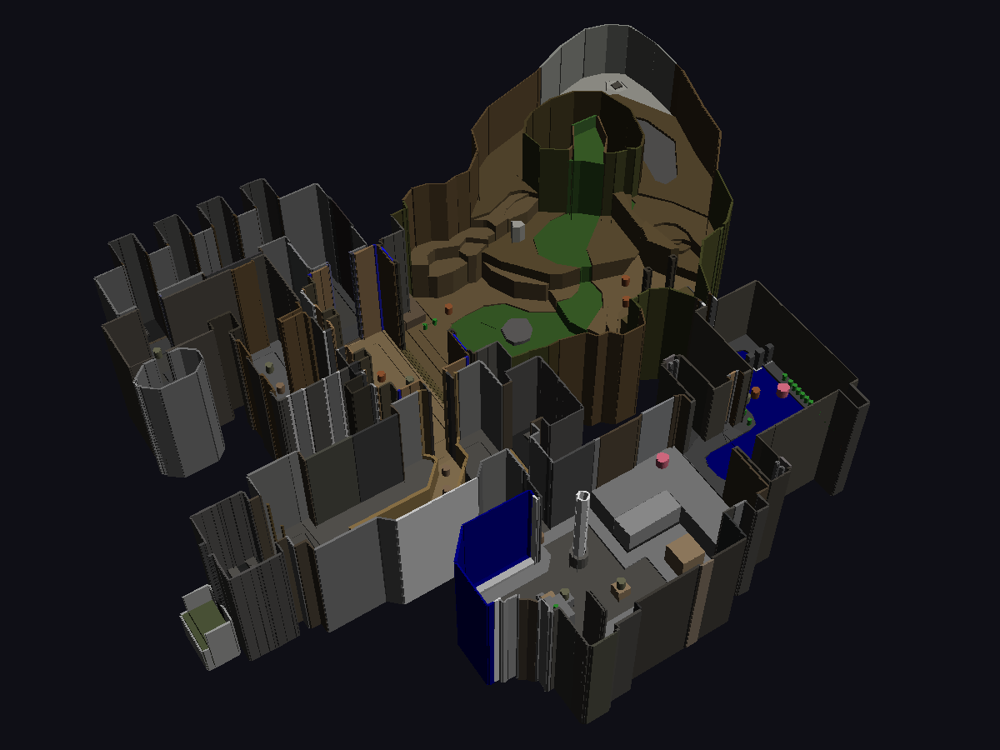

# Geant4Doom

Play Doom inside [Geant4](https://geant4.web.cern.ch/), the particle-physics simulation toolkit.
Every map of a Doom WAD is converted into Geant4 GDML geometry (concrete walls, water for nukage),
and the weapons fire real particles: electrons, pions, muons, carbon ions, protons and antiprotons,
tracked through the level by Geant4. Monsters are sensitive detectors, and the energy a shot
deposits in them is the damage they take.



The level is drawn the way Doom draws it (textures, sector light, sprites, the sky), with Doom's
own status bar dressed as a piece of an accelerator. Doors, lifts, switches, keys, pickups,
barrels, the intermission screen and level transitions all work as in Doom. Monsters wake, chase
you and fight back. Sound effects and the OPL3 FM music play as they did on a Sound Blaster.

Tested with every map of [Freedoom](https://freedoom.github.io/) Phase 1 and The Ultimate Doom, on
Geant4 11.4.3 on Linux (Qt6, Wayland).

## Contents

- [Requirements](#requirements)
- [Quick start](#quick-start)
- [Controls](#controls)
- [Console commands](#console-commands)
- [What is in the game](#what-is-in-the-game)
- [Rendering without the viewer (Python)](#rendering-without-the-viewer-python)
- [Project layout](#project-layout)
- [How the conversion works](#how-the-conversion-works)
- [Things learned on the way (Geant4 11.4)](#things-learned-on-the-way-geant4-114)
- [Ideas for next steps](#ideas-for-next-steps)
- [License](#license)
- [Credits and legal](#credits-and-legal)

## Requirements

**Converter** (`doom2gdml.py`): Python 3.10+ with `numpy`, `shapely` (2.1 or newer, for
`constrained_delaunay_triangles`) and `pillow`.

**Viewer** (`app/`, the game):
- Geant4 11.4 built with GDML, Qt6 and OpenGL support, with its physics datasets installed
  (FTFP_BERT needs them).
- CMake 3.16+ and a C++20 compiler.
- Qt6 Widgets, OpenGL and OpenGLWidgets. Without Qt6 the viewer still builds, but only for batch
  macros: no textured view, HUD, keyboard or mouse.
- Optional: `libpulse-simple` (PulseAudio or PipeWire) for sound and music.
- Optional, for mouse capture on native Wayland: `wayland-client`, `wayland-protocols`,
  `wayland-scanner` and Qt6 GuiPrivate. On X11 nothing extra is needed.

**A WAD**: [Freedoom](https://github.com/freedoom/freedoom/releases) is free (BSD licence):
`freedoom1.wad` has Doom-1-style maps (E1M1-E4M9). Your own `DOOM.WAD` or `DOOM2.WAD` works too.
No WAD is included here.

## Quick start

```bash
git clone https://github.com/tinuviel1999/Geant4Doom.git && cd Geant4Doom
pip install numpy shapely pillow

# 1. Convert every map of the WAD into one folder (this takes a while; sounds, music, textures,
#    sprites and status-bar graphics are extracted alongside)
python3 doom2gdml.py path/to/freedoom1.wad all -o freedoom1
#    or only some maps:  python3 doom2gdml.py path/to/freedoom1.wad E1M1,E1M2 -o freedoom1

# 2. Build the viewer
cmake -S app -B app/build -DCMAKE_BUILD_TYPE=Release
cmake --build app/build -j

# 3. Play (start on any converted map; exits lead on to the next ones)
app/build/doomviewer freedoom1/e1m1.gdml
```

The viewer opens Geant4's Qt window with the level in first person. The mouse is captured at
once: move it to look, click to fire, and press Esc to get the pointer back for Geant4's menus
and command line.

Notes:
- If you set `GEANT4_DATA_DIR` to a stub for the Python tools (see below), unset it before
  running the viewer: Geant4 11 reads it and would not find the real datasets.
- The viewer reads `vis.mac` from the working directory, or else the copy next to the binary
  (`app/vis.mac`, copied at build time). Edit it to change the startup settings.
- Batch mode, without a window: `app/build/doomviewer freedoom1/e1m1.gdml macro.mac` runs the
  macro and exits (use `/vis/open TSG_OFFSCREEN` in it to render PNGs).

## Controls

| Key / button | Action |
|---|---|
| W / S, Up / Down | walk forward / back (climbs steps, slides along walls) |
| A / D | strafe left / right |
| Q / E, Left / Right | turn |
| Mouse | look around (captured from the start) |
| Left button, or Space | fire (hold for automatic fire) |
| Right button, or F | use: doors, switches, lifts |
| 2-7 | weapons: 2 electron gun, 3 pion scattergun, 4 muon chaingun, 5 carbon-ion cannon, 6 proton rifle, 7 antiproton BFG |
| Esc or M | free the mouse (for Geant4's command line and menus); M captures it again |
| Left-drag | look around while the mouse is free |

Keys are ignored while Geant4's command line has the keyboard focus, so click on the 3D view
(or press M) to play again after typing a command. After dying, fire or use restarts the level.
During the intermission, fire or use hurries it on.

## Console commands

Type these in Geant4's command line (Esc frees the mouse to get there), or put them in a macro.
The Qt window's "Doom" menu has buttons for a few of them.

**Game**

| Command | What it does |
|---|---|
| `/doom/map E1M2` | go to a level (it must be converted, in the same folder) |
| `/doom/next` | end the level now (intermission, then the next level) |
| `/doom/reset` | restart the level, as after a death |
| `/doom/god true` | invulnerable |
| `/doom/idkfa` | every weapon, full ammo, all keys |
| `/doom/monsters false` | freeze the monsters (true: they wake, chase and attack) |
| `/doom/status` | your health, armour, weapon and ammo, and every monster's health |
| `/doom/where` | the eye's position in Geant4 and in Doom map coordinates |

**Weapons and physics**

| Command | What it does |
|---|---|
| `/doom/weapon 4` | take a weapon by Doom slot (2-7) |
| `/doom/fire [n]` | shoot n times along the view (the same as clicking) |
| `/doom/energyPerHP 20 MeV` | the energy deposit that counts as one hit point of damage |
| `/doom/gunDrop 300 mm` | how far below the eye the muzzle sits |

**View and HUD**

| Command | What it does |
|---|---|
| `/doom/textures false` | Geant4's own flat-coloured volumes instead of Doom's textures |
| `/doom/sprites false` | monsters as their physics volumes instead of Doom's sprites |
| `/doom/hitboxes true` | the physics volumes as green wireframes over the sprites |
| `/doom/hudStyle doom` | Doom's own status bar (default `lhc`: the accelerator magnet) |
| `/doom/weaponStyle instruments` | the weapons as particle-physics instruments (default `doom`) |
| `/doom/face physicist` | a restyled face in the status bar (experimental; default `doomguy`) |
| `/doom/crosshair false` | hide the crosshair |
| `/doom/mouseSensitivity 0.15` | mouse look, degrees per mouse count |

**Sound**

| Command | What it does |
|---|---|
| `/doom/volume 0.7` | sound effects volume, 0 to 1 |
| `/doom/music off` | music `on`, `off`, or a song by name (`D_E1M2`, `D_RUNNIN`, ...) |
| `/doom/musicVolume 0.5` | music volume, 0 to 1 |
| `/doom/soundLog true` | print every sound played (gain, pitch, pan) |

**For macros and tests** (the Qt session does these by itself)

| Command | What it does |
|---|---|
| `/doom/walk 400 mm`, `/doom/strafe 400 mm`, `/doom/turn 5 deg` | move the player |
| `/doom/move 384 0 5 0` | forward and right (mm), turn left and look up (deg) at once |
| `/doom/use` | use what is in front of you |
| `/doom/think 0.1 s` | one step of the monsters' AI |
| `/doom/world 1 s` | run the doors, lifts and floors for this much game time |

All of Geant4's own commands work too, for example `/vis/open OGL` (another viewer),
`/run/beamOn 10` (shoot from the last muzzle position) or `/geometry/test/run`.

## What is in the game

### Weapons and damage

Doom's weapons fire real particles from your eye, along the view:

| Slot | Weapon | Particles | Doom's |
|---|---|---|---|
| 2 | electron gun | 300 MeV electrons | pistol |
| 3 | pion scattergun | seven 500 MeV pions | shotgun |
| 4 | muon chaingun | 2 GeV muons (they go through monsters) | chaingun |
| 5 | carbon-ion cannon | 3 GeV carbon nuclei, which stop in the target and dump everything in their Bragg peak | rocket launcher |
| 6 | proton rifle | 1 GeV protons | plasma gun |
| 7 | antiproton BFG | a 90° spray of forty 300 MeV antiprotons that annihilate in whatever they hit; 40 cells a shot, charges for 30 tics like Doom's | BFG 9000 |

Their energies were tuned so that the energy they deposit matches Doom's damage, with Doom's fire
rates, spread and ammo. Monsters are sensitive detectors: the energy a shot deposits in them is
damage (`/doom/energyPerHP`, default 20 MeV), measured against Doom's spawn health. Kills are
printed, and the dead fall as flat corpses that you can step over and shoot past.

As in Doom, you start with the electron gun and 50 rounds. The other weapons and their ammo lie
about the level (clips, shells, rockets, cells, boxes of them, and the backpack that doubles what
you can carry). Zombies and shotgun guys drop their clip or gun when they die. Walking over an
item picks it up, and a new weapon goes straight into your hands.

Health and armour work by Doom's rules: bonuses, stimpacks, medikits, green and blue armour and the
soulsphere (medikits only up to 100%, bonuses and the soulsphere up to 200%). Armour takes a third
(green) or half (blue) of every hit until it runs out. Dying restarts the level as Doom does: you
are back at the start with the electron gun and 50 rounds, and the monsters, doors and items are
as they were.

### Monsters

What you see of a monster is Doom's own sprite: a flat picture standing in the level and turned
towards you, with Doom's frames for walking, attacking, pain and dying, and the side of the monster
that faces you. What the particles hit is a water volume behind it, a cylinder or a ball, which is
hidden. `/doom/hitboxes true` shows these volumes as green wireframes (a detector view).

Monsters wake when they see you or hear a shot, and then chase you. They fight back with Doom's
attacks and timing: zombies and shotgun guys shoot with Doom's spread, demons bite, and imps claw
up close or throw fireballs that you can dodge (drawn with Doom's fireball sprites, bursting where
they hit).

### The level

The level works like Doom's (`app/doomworld.hh`):
- Doors open when used (or when a monster walks into a plain one), wait four seconds, close, and
  back up if you stand in the way.
- Keyed doors want their key card or skull key, which you pick up by walking over it.
- Switches flip their texture, and pop back after a second if they are repeatable.
- Lifts lower, wait and rise with you on them. Floors rise and lower.
- Walk-over lines, teleporters, exits, secret areas, damaging floors and scrolling walls work too.
- Barrels explode when shot. The blast (Doom's 128-unit radius attack, blocked by walls) hurts
  the monsters, the other barrels and you.

A moving floor or ceiling moves the sector's GDML slab, so the particles see the door as well.

### Level end and transitions

An exit ends the level with Doom's intermission, drawn with the WAD's own graphics. First the
tally of kills, items, secrets, time and par counts up. Then the episode's map shows the levels
done and "you are here" on the next one.

The next level follows Doom's order: a secret exit goes to E?M9 and back, M8 leads to the next
episode, and Doom II's MAP15 leads to MAP31. When that level has not been converted, the next one
in the folder comes instead, and after the last level it wraps around to the first. You keep your
health, armour, weapons and ammo, but not the keys.

### Drawing

Geant4's visualisation has no textures, so `doom2gdml.py` (via `doom_surfaces.py`) also writes:
- the map itself (`<map>_level.txt`: sectors, sidedefs, linedefs and the floor triangles);
- the textures (`textures/`).

The viewer builds the surfaces from the current sector heights with Doom's alignment rules. They
move with doors and lifts. The viewer draws them with OpenGL into Geant4's own Qt view, right after
Geant4 has drawn the monsters and the particle tracks, sharing its depth buffer. Sector light fades
with distance as in Doom's renderer, nukage is animated, and the episode's sky is drawn. The GDML
volumes are still what the particles see. On screen they are hidden, and `/doom/textures false`
brings back Geant4's flat colours.

The status bar is Doom's, drawn with the WAD's own graphics. By default it is dressed as a piece
of an accelerator (`lhc_hud.py`): a blue LHC-style dipole with control-room readouts and the face
inside a detector cross-section. It shows health, armour, ammo, keys and Doomguy's face, which
reacts to hits, and the screen flashes red with Doom's damage palette. `/doom/weaponStyle
instruments` swaps the weapons in your hands for particle-physics instruments (`weapon_sprites.py`,
a first version): a glass electron gun, a magnetic focusing horn, a copper RF linac, a frosted
blue cryostat, an SRF cryomodule and a Penning trap full of antiprotons.

### Sound and music

With libpulse-simple (PulseAudio or PipeWire), the viewer plays the WAD's own sound effects,
positioned and panned as in Doom. The hit sound follows the physics: the more energy a shot
deposits, the louder and deeper the scream.

The level's music plays the way it sounded on a Sound Blaster. The WAD's MIDI songs (MUS songs
from the id WADs are converted) play on an emulated OPL3 FM chip
([Nuked-OPL3](https://github.com/nukeykt/Nuked-OPL3)) with the WAD's own instrument bank
(GENMIDI), driven as Doom's DMX library did.

## Rendering without the viewer (Python)

Without a Geant4 C++ install, `render_g4.py` renders the converted geometry with Geant4's own
drivers through `pip install geant4_pybind`. That includes the RayTracer, where every pixel is a
geantino tracked through the level by the Geant4 navigator.



```bash
pip install geant4_pybind shapely numpy pillow
mkdir -p e1m1 && cd e1m1
python3 ../doom2gdml.py path/to/freedoom1.wad E1M1 -o e1m1.gdml
#  -> e1m1.gdml, e1m1.json, e1m1_camera.mac, e1m1_camera_rt.mac, e1m1_gun.mac, ...

# geant4_pybind wants datasets at import; geometry and visualisation need none:
mkdir -p ~/g4stub/ENSDF && touch ~/g4stub/ENSDF/ENSDFSTATE.dat
export GEANT4_DATA_DIR=~/g4stub G4ENSDFSTATEDATA=~/g4stub/ENSDF

# run from the folder holding e1m1.gdml and its .mac files
python3 ../render_g4.py e1m1.gdml ../macros/firstperson.mac           # TSG offscreen PNG
python3 ../render_g4.py e1m1.gdml ../macros/raytrace.mac              # RayTracer JPEG
python3 ../render_g4.py --hide=_ceil e1m1.gdml ../macros/overview.mac # roofless bird's-eye view

python3 ../flythrough.py path/to/freedoom1.wad E1M1 e1m1.json --driver RayTracer --frames fr --out demo.mac
(cd fr && python3 ../../render_g4.py ../e1m1.gdml ../demo.mac)
python3 ../flythrough.py --gif fr demo.gif
```

| RayTracer | Overview |
|---|---|
|  |  |

## Project layout

| Path | What it is |
|---|---|
| `doom2gdml.py` | the converter: WAD -> GDML, camera macros, sounds, music, HUD graphics, sprites |
| `doom_surfaces.py` | the map and textures for the textured view (called by the converter) |
| `lhc_hud.py`, `physicist_face.py`, `weapon_sprites.py` | the restyled status bar, face and weapons (called by the converter) |
| `app/doomviewer.cc` | the game: Geant4 application, gameplay, HUD, input, textured view |
| `app/doomworld.hh` | Doom's doors, lifts, floors, switches and line specials |
| `app/doommusic.hh` | the MIDI player on the OPL3 emulator |
| `app/vis.mac` | the viewer's startup macro |
| `render_g4.py`, `flythrough.py`, `macros/` | rendering through geant4_pybind |
| `CLAUDE.md` | detailed development notes: design decisions, Geant4 gotchas, test methods |

## How the conversion works

- Doom maps are 2.5D: each sector is a 2D region with floor and ceiling heights.
- The WAD already contains a BSP tree. Clipping a big rectangle by every
  partition line, then by the segs of each leaf, gives the exact convex polygon
  of every subsector (the same trick GL source ports use). No node builder needed.
- Per sector, the pieces are merged with shapely, triangulated with GEOS
  constrained Delaunay and extruded into closed `G4TessellatedSolid`s:
  a floor slab (bottom of world up to the floor) and a ceiling slab (ceiling up to
  the top). Sky sectors get no ceiling slab.
- One-sided linedefs become thin wall prisms just outside the sector, clipped so
  they do not overlap anything.
- Monsters and barrels are tubes and orbs. Liquids are `G4_WATER`, the rest is
  `G4_CONCRETE`.
- Colour is the average colour of each flat or wall texture, from the WAD's own
  PLAYPAL, PNAMES/TEXTURE1 and patches, scaled by sector light. It is stored as
  `<auxiliary auxtype="Color">`.
- Scale: 1 map unit = 32 mm. Axes: G4 y is up (see below).

Freedoom's E1M1 gives 942 volumes and 10k vertices. `/geometry/test` reports only one 3 mm
wall contact and two monsters standing over a step edge.

## Things learned on the way (Geant4 11.4)

1. **MT RayTracer ignores the up vector.** `G4RTPrimaryGeneratorAction::SetUp()`
   copies eye position, direction and span from `G4TheMTRayTracer`, but not `up`
   or `headAngle`, so it always assumes up = +y. A z-up world comes out rolled 90°.
   That is why the GDML is written y-up. Worth a bug report.
2. **The scene extent is computed from visible volumes only.** With an invisible
   world, the extent radius is not the world's. The camera macros therefore add
   `/vis/scene/add/extent` with the world box, so the `dollyTo` maths, which puts
   the camera exactly at the player's eyes, is exact.
3. **Field of view differs by driver.** OpenGL/TSG apply the field half-angle
   vertically; the RayTracer applies it horizontally. Hence two camera macros.
4. **TSG_OFFSCREEN (software z-buffer) mangles large triangles that cross the
   near plane.** Walking close to walls gives garbage, so the fly-through uses the
   RayTracer. The interactive OpenGL drivers clip properly.
5. **Swapping the whole geometry in an MT (task) run manager.** Each worker keeps per-thread
   arrays for every logical volume, placement and region. `/run/initialize` makes the workers set
   up the new world before they copy the new volumes' data, and they abort with GeomNav0002.
   Calling `InitializeGeometry()` on the master doesn't help either: the workers' own
   `/gun/position` checks the vertex against the old, deleted world. So the viewer:
   - calls `InitializeGeometry()` on the master;
   - broadcasts a command that, on each worker, frees and re-copies those arrays and then calls
     `G4WorkerThread::UpdateGeometryAndPhysicsVectorFromMaster()`;
   - passes the gun's position outside the UI.

   The arrays grow in chunks of 512, and Geant4's own re-copy memcpys the master's bigger array
   into the worker's smaller one, so the bug only shows after a few levels.
6. **geant4_pybind specifics:** `GEANT4_DATA_DIR` skips the dataset download
   prompt. `G4NuclideTable` still needs `G4ENSDFSTATEDATA` (an empty file is
   enough). The RayTracer in an MT build needs an MT run manager and an action
   initialization with a generator.

## Ideas for next steps

- Crushing ceilings, light effects (flickering, glowing sectors), the remaining line specials
  (the viewer says which one when used), and the remaining powerups.
- Monster infighting, and Doom-accurate monster logic (for example via doomgeneric).
- The intermission's animated backgrounds, and the text screens between episodes.
- Sprites for the decorations (lamps, columns), which are still plain volumes.

## License

Geant4Doom is free software, licensed under the GNU General Public License, version 2 or (at
your option) any later version (`GPL-2.0-or-later`). See [LICENSE](LICENSE). The bundled
Nuked-OPL3 keeps its own licence (LGPL-2.1, see below).

## Credits and legal

- Doom is a trademark of id Software. This project contains no id Software data. The converter
  reads a WAD you supply, and the converted output (GDML, textures, sprites, sounds, music) is a
  derivative of that WAD: share conversions of Freedoom freely, but keep conversions of the
  commercial WADs to yourself.
- [Freedoom](https://freedoom.github.io/) is BSD-licensed. The screenshots in `docs/` are from
  Freedoom.
- [Nuked-OPL3](https://github.com/nukeykt/Nuked-OPL3) by nukeykt, LGPL-2.1, is included in
  `app/third_party/nuked-opl3` with its licence.
- The DMX music driver was written from the behaviour documented by Chocolate Doom's
  `i_oplmusic.c` (consulted, not copied).
- [Geant4](https://geant4.web.cern.ch/) is the Geant4 Collaboration's, under the Geant4 Software
  Licence.
